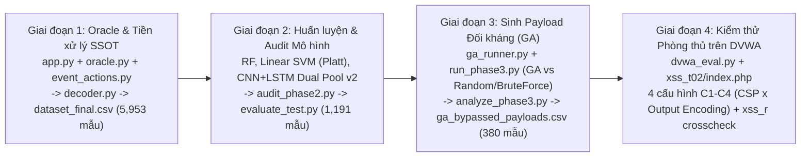

# Đề tài T02: Phát hiện XSS bằng Học máy và Sinh Payload tự động để Kiểm thử Mô hình

## 1. Thông tin Đồ án & Câu hỏi Nghiên cứu

- **Đề tài:** T02 — *Phát hiện XSS bằng Học máy và Sinh Payload tự động để Kiểm thử Mô hình*
- **Giảng viên hướng dẫn:** Ngô Khánh Khoa
- **Nhóm thực hiện:** Nhóm 10

| STT | Họ và tên | MSSV |
| :---: | :--- | :---: |
| 1 | Dương Đăng Chính | 24520222 |
| 2 | Lê Văn Chí | 24520214 |
| 3 | Nguyễn Hữu Chiến | 24520218 |
| 4 | Tsằn Chí Khoan | 24520852 |
| 5 | Nguyễn Lâm Minh Khoa | 24520830 |

**Câu hỏi nghiên cứu trung tâm:**
> Làm thế nào để xây dựng một quy trình phát hiện Cross-Site Scripting (XSS) bằng Học máy / Học sâu (ML/DL) không phụ thuộc vào shortcut ngữ nghĩa, kiểm thử độ bền đối kháng (*adversarial robustness*) của từng mô hình bằng thuật toán di truyền (*Genetic Algorithm — GA*) kết hợp trình duyệt thực (*Playwright Oracle*), và đánh giá hiệu quả phòng thủ thực tế (*defense-in-depth*) của các payload vượt qua kiểm duyệt (*bypass*) trên ứng dụng DVWA dưới tác động của **Content Security Policy (CSP)** và **Context-Aware Output Encoding**?

---

## 2. Kiến trúc Hệ thống & Cấu trúc Thư mục

### Luồng xử lý End-to-End 4 Giai đoạn



1. **Giai đoạn 1 — Playwright Oracle & Tiền xử lý SSOT:** Xác thực khả năng thực thi thực tế của payload qua các ngữ cảnh (`html_body`, `attribute`, `js_string`, `url`) bằng Playwright Chromium (`app.py`, `oracle.py`, `event_actions.py`). Chuẩn hóa giải mã theo nguồn chân lý duy nhất (*Single Source of Truth — SSOT*) tại `preprocessing/decoder.py` (`decode_payload`), tạo tập lành tính (`Clean` và `Unusual`) và chia tập `train / val / test` theo `family` bằng *Constrained Multi-trial Group Split* (`dataset_final.csv`: `5,953` mẫu = `4,167` train / `595` val / `1,191` test; không rò rỉ `family` giữa các split).
2. **Giai đoạn 2 — Huấn luyện, Audit & Đánh giá 3 Mô hình ML/DL:** Huấn luyện `Random Forest` (`rf_best.joblib`), `Linear SVM + StratifiedGroupKFold Platt Calibration` (`svm_best.joblib`) trên `5,011` đặc trưng (`TF-IDF` + `11` đặc trưng cấu trúc) và `Char-level CNN+LSTM Dual Pool v2` (`vocab_size=97`, `max_len=200`, 3 seed `42/102/202`), kiểm tra shortcut/domain-swap/OOD/margin (`audit_phase2.py`), và đánh giá một lần trên tập Test (`evaluate_test.py`).
3. **Giai đoạn 3 — Tấn công Đối kháng bằng GA vs Baseline:** Chạy `GA` (`population=60`, `generations=40`, `patience=7`, `crossover_rate=0.75`, `mutation_rate=0.10`, `tournament_k=3`, `elitism_ratio=0.05`) đối chứng với `Random Search` (cùng ngân sách mẫu duy nhất `unique_total`) qua 5 seed (`0..4`) trên 3 ngữ cảnh lớn (`html_body`, `attribute`, `js_string`) và `Brute Force` toàn bộ không gian `26` ứng viên ở ngữ cảnh `url`, sử dụng `OracleCache` (`7,615` mục đã cache). Xuất `380` payload duy nhất hợp lệ (`valid=1`) vượt qua ít nhất một mô hình ra `ga_bypassed_payloads.csv`.
4. **Giai đoạn 4 — Đánh giá Phòng thủ Thực tế trên DVWA:** Kiểm thử toàn bộ `380` payload GA-bypass trên DVWA endpoint `/vulnerabilities/xss_t02/index.php` qua 4 cấu hình **C1–C4** (`CSP × Context-Aware Output Encoding`) và đối chiếu chéo `60/60` mẫu `html_body` với endpoint gốc `/vulnerabilities/xss_r/` (`security=low`).

### Cấu trúc Thư mục

```text
XSS_MODEL/
├── .gitignore
├── README.md
├── malicious_payloads_mixed_3060_v8.csv      # Tập payload độc hại nguồn ban đầu
├── tier_event.txt                            # Phân tầng event tương tác Oracle
└── xss_pipeline/
    ├── requirements.txt                      # 8 thư viện cốt lõi đã ghim phiên bản
    ├── app.py                                # Flask testbed sink theo 4 ngữ cảnh
    ├── event_actions.py                      # Bảng ánh xạ event -> thao tác Playwright (SSOT)
    ├── oracle.py                             # Bộ thực thi Playwright Chromium Oracle
    ├── filter_dataset.py                     # Lọc payload thực thi thật (có resume/checkpoint)
    ├── verify_pipeline.py                    # Kiểm tra tính đúng đắn Oracle pipeline
    ├── benign_dataset_4000.csv               # 4,000 mẫu lành tính (2,000 Clean + 2,000 Unusual)
    ├── dataset_final.csv                     # Tập dữ liệu cuối 5,953 mẫu (train/val/test)
    ├── ga_bypassed_payloads.csv              # 380 payload bypass duy nhất từ Giai đoạn 3
    ├── preprocessing/                        # Giải mã SSOT & xây dựng dataset_final.csv
    ├── models/
    │   ├── features.py                       # Trích xuất TF-IDF + 11 đặc trưng cấu trúc & char seq
    │   ├── predictor.py                      # ModelPredictor thống nhất cho RF, SVM, CNN+LSTM
    │   ├── train_classical.py                # Huấn luyện RF & Linear SVM
    │   ├── train_cnn_lstm.py                 # Huấn luyện Char-level CNN+LSTM (seeds 42, 102, 202)
    │   ├── audit_phase2.py                   # Kiểm toán Margin, Action-Swap & OOD
    │   ├── evaluate_test.py                  # Đánh giá 1 lần trên tập Test (1,191 mẫu)
    │   └── artifacts/                        # Weights (.joblib, .pt) & báo cáo JSON
    ├── ga/
    │   ├── genes.py                          # Không gian gen theo 4 ngữ cảnh
    │   ├── build.py                          # Lắp ghép cá thể gen -> chuỗi payload
    │   ├── ga_runner.py                      # GA / Random / Brute Force + OracleCache
    │   ├── run_phase3.py                     # Điều phối full run & tổng hợp phase3_summary.json
    │   ├── analyze_phase3.py                 # Ma trận 6.2, Error Analysis & Transferability
    │   └── results_full/                     # Kết quả JSON từng seed & báo cáo tổng hợp
    ├── dvwa/
    │   ├── docker-compose.yml                # Dựng DVWA container (port 127.0.0.1:8080)
    │   ├── xss_t02/index.php                 # Endpoint thực nghiệm 4 cấu hình C1–C4
    │   ├── dvwa_eval.py                      # Đánh giá tự động 380 mẫu + crosscheck xss_r
    │   ├── test_dvwa_unit.py                 # Unit test thuần Python cho DVWA evaluator
    │   └── results/                          # Log JSONL & phase4_dvwa_report.json
    └── test_*.py                             # Unit tests (decoder, features, predictor, ga, regressions)
```

---

## 3. Tóm tắt Kết quả Thực nghiệm Chính

### Bảng 1. Hiệu năng trên Tập Test Độc lập (`test_evaluation_report.json`, `n = 1,191`)

Tập Test gồm `391` mẫu độc hại (`276` Tainted + `115` Obfuscated) và `800` mẫu lành tính (`400` Clean + `400` Unusual), tách biệt hoàn toàn theo `family`.

| Mô hình | Ngưỡng (Val) | Precision | Recall | Test F1 | TP / FP / TN / FN | FPR (All Benign) |
| :--- | :---: | :---: | :---: | :---: | :---: | :---: |
| **Random Forest (`rf_best`)** | `0.50` | `1.0000` | `1.0000` | **`1.0000`** | `391 / 0 / 800 / 0` | `0.00%` |
| **CNN+LSTM (TB 3 seed: `42/102/202`)** | — | `0.9983 ± 0.0015` | `0.9974 ± 0.0026` | **`0.9979 ± 0.0015`** | — | `0.08% ± 0.07%` |
| **CNN+LSTM (`seed=202`, đại diện)** | `0.57` | `0.9974` | `0.9949` | **`0.9962`** | `389 / 1 / 799 / 2` | `0.13%` |
| **Linear SVM (`svm_best`)** | `0.40` | `0.9874` | `1.0000` | **`0.9936`** | `391 / 5 / 795 / 0` | `0.63%` |

### Bảng 2. Tỷ lệ Bypass (`Bypass Rate A = unique_bypass / unique_valid`) & Cross-Model Transferability (`phase3_summary.json`, `phase3_analysis_report.json`)

Với 3 ngữ cảnh lớn (`html_body`, `attribute`, `js_string`), các giá trị dưới đây là **Mean ± Std** qua `5` seed (`0..4`). Với ngữ cảnh `url`, do không gian tìm kiếm chỉ có `26` payload (`25` `valid=1`), thực nghiệm chạy **Brute Force** toàn bộ không gian (`seed=0`).

| Mô hình | Ngữ cảnh | Phương pháp | `unique_valid` (TB) | `unique_bypass` (TB) | Bypass Rate A |
| :--- | :--- | :--- | :---: | :---: | :---: |
| **RF** | `html_body` | GA / Random | `242.0` / `174.4` | `0.0` / `0.0` | `0.00%` / `0.00%` |
| **RF** | `attribute` | GA / Random | `323.8` / `263.8` | `0.0` / `0.0` | `0.00%` / `0.00%` |
| **RF** | `js_string` | GA vs Random | `283.4` / `218.2` | `16.0` / `7.8` | **`5.70% ± 0.61%`** vs `3.56% ± 0.36%` |
| **RF** | `url` | Brute Force | `25` | `0` | `0.00%` |
| **SVM** | `html_body` | GA / Random | `218.2` / `157.0` | `0.0` / `0.0` | `0.00%` / `0.00%` |
| **SVM** | `attribute` | GA / Random | `307.6` / `259.4` | `0.0` / `0.0` | `0.00%` / `0.00%` |
| **SVM** | `js_string` | GA vs Random | `214.4` / `173.8` | `2.0` / `1.2` | **`0.94% ± 0.12%`** vs `0.68% ± 0.48%` |
| **SVM** | `url` | Brute Force | `25` | `13` | **`52.00%`** (`data:` `12/12`, `js:` `1/13`) |
| **CNN+LSTM (`s202`)** | `html_body` | GA vs Random | `215.4` / `174.6` | `53.2` / `11.2` | **`24.83% ± 1.92%`** vs `6.42% ± 2.16%` |
| **CNN+LSTM (`s202`)** | `attribute` | GA vs Random | `278.6` / `263.0` | `92.0` / `14.4` | **`33.31% ± 3.67%`** vs `5.47% ± 0.77%` |
| **CNN+LSTM (`s202`)** | `js_string` | GA vs Random | `278.2` / `245.4` | `113.6` / `11.2` | **`41.34% ± 4.53%`** vs `4.53% ± 1.24%` |
| **CNN+LSTM (`s202`)** | `url` | Brute Force | `25` | `0` | `0.00%` |

- **Cross-Model Transferability = `0%` (`0/380`):** Tổng hợp từ toàn bộ quá trình chạy GA/Brute Force thu được **`380` payload bypass duy nhất** (`ga_bypassed_payloads.csv`), trong đó `349` mẫu chỉ bypass `CNN+LSTM`, `16` mẫu chỉ bypass `RF`, và `15` mẫu chỉ bypass `SVM`. Giao thoa giữa bất kỳ cặp mô hình nào (`RF ∩ SVM`, `RF ∩ CNN+LSTM`, `SVM ∩ CNN+LSTM`) và cả 3 mô hình đều bằng **`0`**.

### Bảng 3. Đối chiếu Phòng thủ trên DVWA C1–C4 (`phase4_dvwa_report.json`, `n = 380`)

Toàn bộ `380` mẫu GA-bypass (`html_body`: `60`, `attribute`: `125`, `js_string`: `182`, `url`: `13`) được kiểm thử trực tiếp trên DVWA (`/vulnerabilities/xss_t02/index.php`) dưới 4 cấu hình phòng thủ:

| Cấu hình | Mô tả Phòng thủ | `html_body` | `attribute` | `js_string` | `url` | Tổng Executed | Tỷ lệ Chặn so với C1 |
| :---: | :--- | :---: | :---: | :---: | :---: | :---: | :---: |
| **C1** | Baseline (No CSP, No Encoding) | `60/60` | `125/125` | `182/182` | `13/13` | **`380/380`** | `0.00%` |
| **C2** | CSP Only (`script-src 'self'; object-src 'none';`) | `0/60` | `0/125` | `0/182` | `0/13` | **`0/380`** | **`100.00%`** |
| **C3** | Context-Aware Output Encoding Only | `0/60` | `0/125` | `0/182` | `0/13` | **`0/380`** | **`100.00%`** |
| **C4** | CSP + Context-Aware Output Encoding | `0/60` | `0/125` | `0/182` | `0/13` | **`0/380`** | **`100.00%`** |

- **Đối chiếu chéo endpoint gốc DVWA (`/vulnerabilities/xss_r/`, `security=low`):** **`60/60`** mẫu `html_body` đều thực thi thành công trên cả `C1` và `/vulnerabilities/xss_r/` (`both_executed_count = 60`), xác nhận tính tương đương của harness `xss_t02` với DVWA gốc.
- **Quan sát `<iframe src="data:text/html,...">` ở C2:** Toàn bộ `12/12` mẫu bị CSP chặn (`executed=0`, phát sinh `securitypolicyviolation` ở `script-src-elem`).

---

## 4. Hướng dẫn Cài đặt & Tái lập (Reproducibility)

### Môi trường Kiểm thử & Khóa Seed

- **Hệ điều hành:** Ubuntu Linux
- **Python:** `3.13.7`
- **GPU:** NVIDIA GeForce RTX 3050 (`device_used: "cuda"` cho huấn luyện `CNN+LSTM`)
- **Trình duyệt Oracle:** Playwright `1.65.1` + Chromium `v1254`
- **Toàn bộ Seed đã khóa:**
  - Chia dữ liệu (`build_benign_dataset.py`, `build_final_dataset.py`) và mô hình cổ điển (`train_classical.py`): `SEED = 42`
  - Huấn luyện `CNN+LSTM` (`train_cnn_lstm.py`): `SEEDS = (42, 102, 202)` (mô hình đại diện: `seed = 202`)
  - Sinh payload đối kháng Giai đoạn 3 (`run_phase3.py`): `seeds = [0, 1, 2, 3, 4]` cho GA & Random; `seed = 0` cho Brute Force (`url`)

### Cài đặt Môi trường & Dựng DVWA

```bash
# 1. Tạo môi trường ảo Python 3.13 và cài đặt 8 thư viện cốt lõi
python3.13 -m venv xss_pipeline/venv
source xss_pipeline/venv/bin/activate
pip install -r xss_pipeline/requirements.txt

# 2. Cài đặt trình duyệt Chromium cho Playwright Oracle
playwright install chromium

# 3. Dựng DVWA container cho Giai đoạn 4 (cổng 127.0.0.1:8080)
docker compose -f xss_pipeline/dvwa/docker-compose.yml up -d
```

> **Lưu ý khi chạy DVWA lần đầu:** Nếu container mới khởi tạo chưa có database, mở `http://127.0.0.1:8080/setup.php` và nhấn **Create / Reset Database** trước khi chạy `dvwa_eval.py`.

### Lệnh Chạy lại Từng Giai đoạn

Mọi lệnh dưới đây thực thi từ thư mục `xss_pipeline/` (đã kích hoạt `venv`):

```bash
cd xss_pipeline

# 0. Chạy Unit Tests thuần Python (không cần Flask app hay Docker)
python -m unittest test_decoder.py test_features.py test_predictor.py test_ga_unit.py dvwa/test_dvwa_unit.py

# 1. Giai đoạn 1 — Oracle & Tiền xử lý SSOT (mở Flask app ở terminal riêng trước)
# Terminal 1:
python app.py
# Terminal 2:
python verify_pipeline.py ../malicious_payloads_mixed_3060_v8.csv --concurrency 8 --concurrent-size 60
python filter_dataset.py ../malicious_payloads_mixed_3060_v8.csv --seed 2
python -m preprocessing.build_benign_dataset
python -m preprocessing.build_final_dataset

# 2. Giai đoạn 2 — Huấn luyện, Audit & Đánh giá Test
python -m models.train_classical
python -m models.train_cnn_lstm
python -m models.audit_phase2
python -m models.evaluate_test

# 3. Giai đoạn 3 — Tấn công GA vs Baseline & Phân tích Transferability (cần app.py đang chạy)
python -m ga.run_phase3
python -m ga.analyze_phase3

# 4. Giai đoạn 4 — Đánh giá Phòng thủ trên DVWA (cần DVWA Docker đang chạy)
python -m dvwa.dvwa_eval
```

---

## 5. Demo Nhanh

`[Sẽ cập nhật lệnh demo.py sau khi hoàn thiện kịch bản Demo]`

---

## 6. Tài liệu Tham khảo

1. Kaur, J., Garg, U., & Bathla, G. (2023). *Detection of cross-site scripting (XSS) attacks using machine learning techniques: a review*. Artificial Intelligence Review.
2. Zhang, X., Zhou, Y., Pei, S., Zhuge, J., & Chen, J. (2020). *Adversarial Examples Detection for XSS Attacks Based on Generative Adversarial Networks*. IEEE Access.
3. Liu, Z., Fang, Y., Huang, C., & Xu, Y. (2022). *GAXSS: Effective Payload Generation Method to Detect XSS Vulnerabilities Based on Genetic Algorithm*. Security and Communication Networks.
4. Tadhani, J. R., Vekariya, V., Sorathiya, V., Alshathri, S. I., & El-Shafai, W. (2024). *Securing web applications against XSS and SQLi attacks using a novel deep learning approach*. Scientific Reports, 14, 1803.
5. Hannousse, A., Yahiouche, S., & Nait-Hamoud, M. C. (2024). *Twenty-two years since revealing cross-site scripting attacks: A systematic mapping and a comprehensive survey*. Computer Science Review, 52, 100634.
